<picture><source media="(prefers-color-scheme: dark)" srcset="assets/banner-dark.svg"></picture>

  <picture><source media="(prefers-color-scheme: dark)" srcset="assets/card-community-dark.svg"></picture>
  <picture><source media="(prefers-color-scheme: dark)" srcset="assets/card-work-dark.svg"></picture>

  <picture><source media="(prefers-color-scheme: dark)" srcset="assets/card-study-dark.svg"></picture>
  <picture><source media="(prefers-color-scheme: dark)" srcset="assets/card-craft-dark.svg"></picture>

### Now

- **[FlowGT](https://github.com/GabrielPower1969/flowgt-open-source)** — a job-search service for New Zealand, built in the open: matching, consent evidence, CV encryption, deletion on schedule.
- **[Interview skills](https://github.com/GabrielPower1969/InterviewPreparationSkill)** — Claude Code skills that prepare for an interview and debrief the recording afterwards.
- **[CITANZ](https://github.com/CITANZ)** — tools for the Christchurch IT community: meetup posters, videos, the website.

### Elsewhere

[onemorething.today](https://onemorething.today) · Christchurch, New Zealand

中文速览：陈广宇，Trimble 软件工程师，住在基督城。业余做求职服务 FlowGT、面试准备与复盘工具，以及 CITANZ 社区的活动工具。
